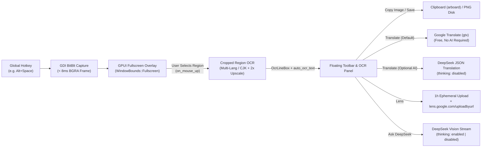

# WinLook — System Architecture & Technical Design

## 1. Design Philosophy & Anti-Scope

WinLook is designed around a single rule: **it must feel as fast as ShareX or the built-in Windows `Win+Shift+S` snipping tool while delivering instant OCR, translation, Google Lens visual search, and optional multimodal AI.**

### What We Intentionally Do NOT Build (Anti-Scope)
- **No WebView / Browser Engine:** Neither Electron nor Tauri WebView2 is used. The UI is 100% GPU-rendered via Rust `gpui` + `gpui-component` (DirectX + DirectWrite on Windows).
- **No Console Terminal Window:** Built with `#![windows_subsystem = "windows"]` across all profiles so `winlook.exe` runs purely as a Windows System Tray daemon.
- **No Bundled OCR / ML Weights:** We do not bundle 150MB+ Tesseract or ONNX models. Local OCR uses the OS-native `Windows.Media.Ocr` API (`Windows::Globalization::Language` + `OcrEngine`).
- **No Plaintext Secret Storage:** API keys live exclusively in the native **Windows Credential Manager (`wincred.h`)** via `keyring` (`features = ["windows-native"]`), never in `config.json`.

---

## 2. Core Pipeline

---

## 3. Subsystem Breakdown

### 3.1 System Tray Daemon & Hotkey Manager (`src/main.rs`)
- Runs silently in the Windows System Tray (`tray-icon` crate) with a live-reloadable global shortcut (`global-hotkey` crate).
- Double-clicking the tray icon or choosing `Preferences...` from the tray menu opens the Preferences window.
- Supports `--silent` startup via `HKCU\Software\Microsoft\Windows\CurrentVersion\Run\WinLook`.

### 3.2 Zero-Lag Screen Capture & On-Demand Cropping (`src/capture.rs`)
- Captures the primary screen via Win32 GDI `BitBlt` + `GetDIBits` into a single `Arc<Vec<u8>>` BGRA buffer.
- Performs a single 32-bit word pass (`*px |= 0xFF00_0000`) to set opaque alpha and passes the buffer directly to `gpui::RenderImage` **without** cloning or RGBA-swapping the entire fullscreen image upfront.
- Converts BGRA → RGBA strictly on the cropped sub-rectangle when the user copies, saves, or runs OCR/Vision on a selection.

### 3.3 Multi-Language & CJK Local OCR (`src/ocr.rs`)
- Runs on-demand on the **selected region** (`recognize_cropped_region_sync`) rather than encoding the entire fullscreen image on startup, eliminating startup lag.
- **2× Upscaling for Small Selections:** If a selected region is smaller than `900px` wide or `300px` tall, `encode_crop_png_for_ocr` upscales the crop 2× before passing it to `Windows.Media.Ocr` and scales the resulting bounding boxes back to 1× screen coordinates, dramatically improving Kanji/CJK accuracy.
- **Multi-Script / Japanese (`ja`) Recognition:**
  - `OcrEngine::TryCreateFromUserProfileLanguages()` only uses the primary Windows display language (whose Latin recognizer ignores Japanese Kanji/Hiragana/Katakana).
  - In `"auto"` mode, WinLook queries `OcrEngine::AvailableRecognizerLanguages()` and checks installed CJK recognizers (`ja`, `zh`, `ko`) via `OcrEngine::TryCreateFromLanguage`, automatically selecting the CJK recognizer when CJK characters are present.
- **CJK Space Normalization (`clean_cjk_spacing`):** Strips artificial spaces inserted by `Windows.Media.Ocr` between adjacent Japanese/Chinese characters (`"日 本 語"` → `"日本語"`) while preserving Latin word spacing.

### 3.4 GPUI Fullscreen Overlay, Inspector & Preferences (`src/ui/`)
- **Fullscreen Overlay (`src/ui/mod.rs`, `src/ui/overlay.rs`):**
  - Uses `WindowBounds::Fullscreen(bounds)` and `WindowBackgroundAppearance::Opaque` so GPUI places its window at exact `(0, 0, width, height)` monitor bounds without any non-client caption/border vertical shift.
- **Floating Toolbar & Inspector (`src/ui/inspector.rs`):**
  - Renders a flat, matte dark (`#181818` / `#202020` / `#2A2A2A`) toolbar anchored next to the selection.
  - Hides AI-specific controls when no DeepSeek API key is configured.
  - Includes a quick **`Reason: Off / On`** toggle next to the AI prompt input to control DeepSeek Thinking Mode per query.
- **Preferences Window (`src/ui/settings.rs`):**
  - Uses a scrollable `.overflow_y_scrollbar()` body with native `gpui_component::select::Select` dropdowns (OCR Language, Target Language, Translation Engine, DeepSeek Model, AI Reasoning Mode), `gpui_component::switch::Switch` toggles, and an interactive click-to-record shortcut button.
